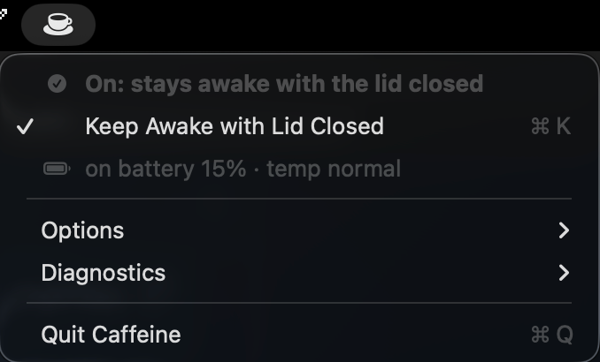
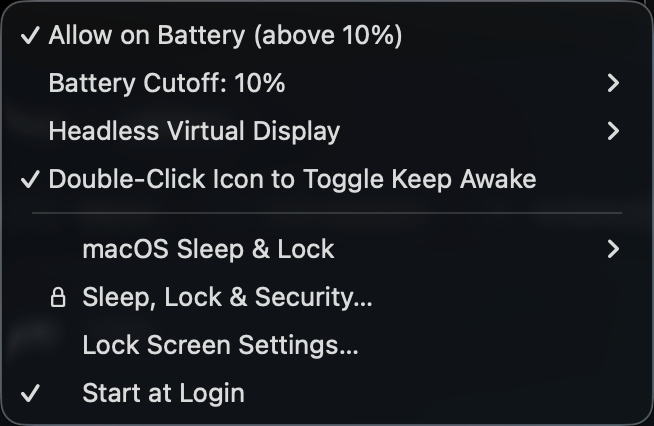

# Caffeine

**Keep your Mac awake—even with the lid closed.** Caffeine is a small macOS menu-bar app for long downloads, background tasks and other work that needs to keep running. Keep your Mac well ventilated while it is awake; don't run it in a bag.

The name and purpose are inspired by Caffeinate.





*Screenshots show an earlier menu and a custom 10% cutoff. New installations default to 15%.*

Requires **macOS 14 or later**. It lives in the menu bar, with no Dock icon. This repository provides source code; see [For Developers](#for-developers) to build and install it. No downloadable installer is currently published.

## How to use

1. Open **Caffeine** from Applications and click the cup in the menu bar.
2. Turn on **Caffeine**. If **Set Up Permission…** appears, open it, copy the setup command, then paste it into Terminal and enter your administrator password. This is a one-time setup.
3. Check the status before closing the lid. A **filled cup** means Caffeine is keeping your Mac awake; an **outline cup** means it is off. A **warning triangle** means protection is paused—open the menu for the reason.
4. Turn Caffeine off, or choose **Quit**, to restore normal sleep.

Click the cup to open the menu. Double-click toggling is off by default and can be enabled in **Other Options**; when enabled, single-click opens the menu after a short delay.

## Useful options

- **Allow on Battery:** on by default for new installations; your saved choice is preserved on upgrade. Turn it off to pause protection when you close the lid without a charger. **Battery Cutoff** pauses protection at your chosen percentage; the default is 15%, adjustable from 5–80%.
- **Sleep After Inactivity:** off by default. Choose a period with no keyboard or mouse activity; Caffeine then turns off and requests sleep, even if background work is running. Keyboard or mouse activity restarts the full countdown. If sleep is pending, activity resumes Caffeine and starts a fresh interval, subject to thermal safeguards. The timer runs while the Caffeine app is open.
- **Use Caps Lock as Caffeine Switch:** on by default; an explicitly saved choice is preserved. Caps Lock becomes a dedicated Caffeine switch without capitalising text or passwords. Your original Caps Lock mapping is restored when you disable the option or quit. Its light briefly blinks off every five seconds while Caffeine is selected and blinks faster when an inactivity timer is enabled; some keyboards may not support light control. Caffeine reserves an unused F16–F20 shortcut internally and preserves unrelated key mappings. If it crashes without being relaunched, open Caffeine again to restore the saved mapping; restarting macOS also clears the temporary mapping. Inspired by [Capsomnia](https://github.com/fuji-mak/Capsomnia).
- **Daily Forced Restart:** off by default. Choose 05:00 or another local time. This forcibly restarts the Mac, closing apps and losing unsaved work. It works at the login screen and requests Caffeine after reboot, subject to the battery and thermal guards. Enable Start at Login first; setting or disabling the schedule requires administrator authentication. The schedule remains active when Caffeine quits, so turn it off before uninstalling. Caffeine schedules its own wake event, but a Mac that is powered off or unable to wake may miss the restart. FileVault must be unlocked before Caffeine's helper can run.
- **Start at Login:** opens Caffeine when you sign in and helps it recover after a crash.
- **Diagnostics → macOS Sleep & Lock:** shows your configured sleep, display and password delays. These are settings, not live countdowns. **Diagnostics → Lock Screen Settings…** opens the corresponding system settings.
- **Headless Virtual Display:** leave this off for ordinary use. Enable it only if a screen-sharing or capture app needs a desktop while the lid is closed and no external monitor is connected. It is experimental and may move windows when the temporary display appears or disappears.
- **Personal Hotspot Fallback:** off by default. After three failed internet checks, Caffeine tries to activate and join the most recently connected Apple Personal Hotspot; it waits at least five minutes between attempts. Checks contact Apple and Cloudflare. This experimental feature uses undocumented macOS interfaces and may be unavailable, interrupt connections or use mobile data. It requests Location permission for Wi-Fi scanning; the Apple device must be nearby and available through Instant Hotspot. Caffeine does not store its password.

## Sleep and screen locking

Caffeine keeps the **computer** awake. The display can still turn off, and macOS can still lock the screen. Apps normally keep running while locked, but some apps or screen-sharing tools may pause or ask you to sign in again.

Caffeine does not change your password or locking settings. For more detail, open **Diagnostics → Sleep, Lock & Security…**.

Low battery or unavailable sensors pause Caffeine. Critical thermal pressure turns it off; you can also enable a sustained serious-heat cutoff in **Other Options**. Keep the Mac ventilated and never put it in a bag while running. **Diagnostics** shows temperature, sleep and lock settings, and logs.

## For Developers

### Build and install

Requires Xcode Command Line Tools. Normal builds target the current Mac's architecture; `./build.sh --universal` builds for Apple silicon and Intel. `./package.sh` builds, runs self-tests and produces `build/Caffeine-<version>-universal.pkg`. The installer does not configure the sleep permission, install the optional prelogin job or launch the app. Distribution packages currently have no Developer ID signature or notarization.

```sh
git clone https://github.com/bestutsengineer/caffeine.git
cd caffeine
./build.sh
build/Caffeine.app/Contents/MacOS/Caffeine --selftest
./build.sh --install
open ~/Applications/Caffeine.app
```

Installation refuses to replace a running Caffeine. Quit normally with the lid open before updating. `--selftest` does not change power settings; `--sensors` adds read-only hardware checks. `--selftest --live` changes sleep settings and requires Caffeine to be stopped and the lid open.

### Power control and recovery

Caffeine holds an idle-sleep assertion and, when needed, sets `pmset -a disablesleep 1`. It records overrides it creates and releases only an override recorded for the current boot. An already-enabled external override is left alone. Because the macOS flag has no owner information, changes made by another tool after Caffeine acquires it cannot be distinguished perfectly. This setting also bypasses macOS's low-battery sleep, so battery and thermal guards are essential. Normal Off, Quit, logout and SIGTERM restore sleep; a crash or force kill can leave it disabled until the app restarts or the optional helper restores it.

To restore sleep manually:

```sh
sudo pmset -a disablesleep 0
```

The one-time setup grants only the two sleep-toggle commands through `/etc/sudoers.d/caffeine`. Print the setup command with `Caffeine --permission-command`; revoke it with `sudo rm /etc/sudoers.d/caffeine`. `--handoff` is reserved for guarded updates with a verified replacement and bounded rollback.

### Temperature and performance logs

Diagnostics samples system CPU use, thermal state and available CPU sensors approximately once per minute, retaining 30 days while the app runs. The typical temperature range uses the 5th–95th percentile of active, lid-open samples and requires at least 30 readings over 30 minutes. Private sensor APIs may be unavailable; sleep and downtime leave gaps.

### CLI and local files

Run `~/Applications/Caffeine.app/Contents/MacOS/Caffeine` with:

```text
--status | --on | --off | --refresh | --quit
--set allowOnBattery=0|1
--set stopOnSeriousThermal=0|1
--set minBatteryPercent=5..80
--set doubleClickToToggle=0|1
--set virtualDisplay=0|1
--set startAtLogin=0|1
```

Settings: `~/Library/Preferences/local.caffeine.plist`. Status: `~/Library/Application Support/Caffeine/state.json`. Rotating logs: `~/Library/Logs/Caffeine/events.log`. Logs distinguish system sleep, display sleep and observed lock events; they cannot prove events they did not record.

The virtual display uses private `CGVirtualDisplay` API. It is removed when the lid opens, a real display becomes available or protection stops. Existing preferences are preserved on upgrade. `--test-virtual-display` briefly creates a real display; debug sensor simulation requires `CAFFEINE_DEBUG=1`.

The optional `prelogin-guard/` job needs a root-owned `/Library/Preferences/local.caffeine.prelogin.plist` with `PreferencesPath` pointing to the chosen user's preferences. It uses the saved battery preference and cutoff and declines to enable the override when required data or thermal status is unavailable. It releases its recorded override if preferences disappear, or if a logged-in user's Caffeine process remains absent for at least 90 seconds. This is a fallback, not a guarantee: it requires the helper, ownership record and sleep permission to work, and cannot detect a hung process. It restores only its own recorded override. The helper starts after the encrypted system volume is unlocked; neither the helper nor the GUI runs at the FileVault unlock screen. The GUI starts after user login.

### Contributing and license

Install scanners with `brew install gitleaks trufflehog`, then enable the staged secret check:

```sh
git config core.hooksPath .githooks
```

Scan the working tree and all Git refs before publishing. Keep credentials, personal configuration, builds and diagnostics out of commits. `.env.example` is documentation only; no credentials are required.

Original contributions are licensed under [MIT](LICENSE). [NOTICE.md](NOTICE.md) discloses unresolved attribution for the private-API declarations header; that material is not automatically covered by the original-code license. See [SECURITY.md](SECURITY.md) for security reporting.
